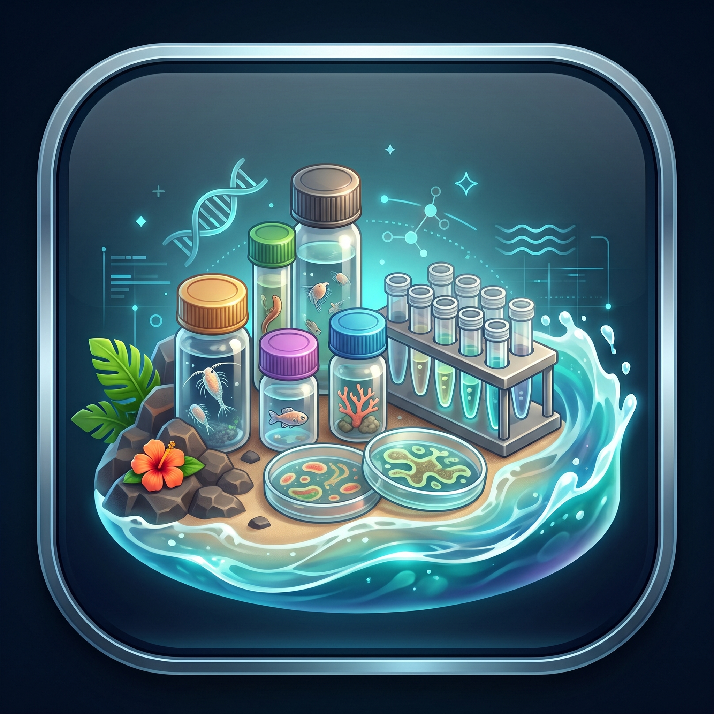

{fig-align="left" width="151"}

### Current System

- Freezerworks

Freezerworks is currently shut down. Vikram pulled the data out of it into an Access database and made a crude front-end for the data so Claudia can verify the data is all there. This file is at A:\Shared drives\NMFS PIC PSD MonkSeal\Freezerworks

### Proposed System

- TBD (incorporated into SPA)

### Proposed Front-End

- TBD
