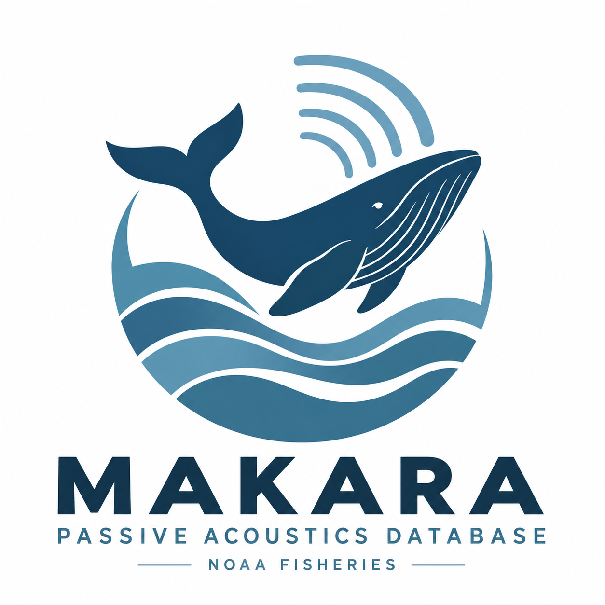

{fig-align="left" width="151"}

### Current System

- [Makara Portal](https://makara-462670382708.us-east4.run.app/)

  - Google: BigQuery
  - PostgreSQL

- [NOAA Passive Acoustics](https://passiveacoustics.fisheries.noaa.gov/)

- [PACM](https://passiveacoustics.fisheries.noaa.gov/pacm/#/)

  - Visualization portal of all NMFS PAM data
