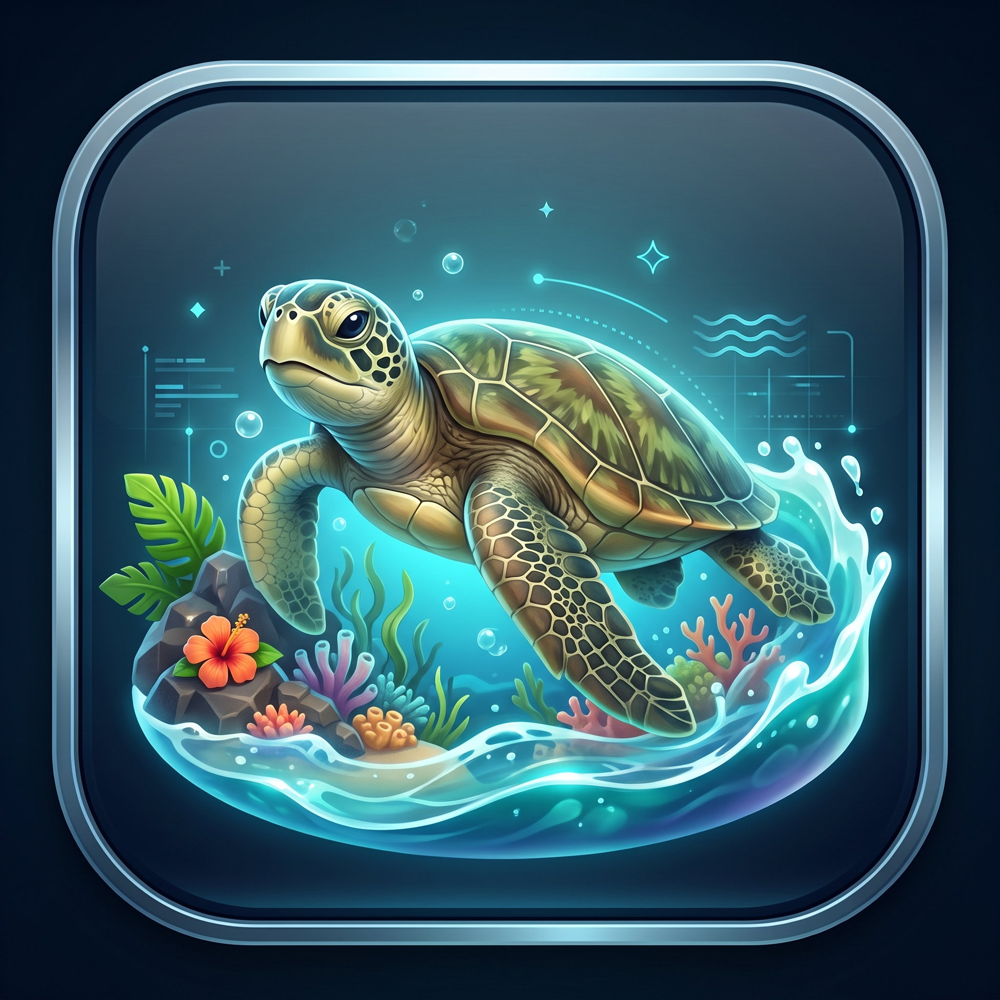

{fig-align="left" width="151"}

### Current System

- Access

**Location**:

**Front-ends at**: A:\Shared drives\NMFS PIC MTBAP Marine Turtle\MTBAP Database_KEEP

Users copy the appropriate file to their local computers and work from there

**What each file does**

TDPS_DataCorrections.accdb: Allows entry and edits to the Turtle database

TDPS_EnterData.accdb: Only for data entry. Meant to be used by less experienced people

TDPS_Queries.accdb: People can run their own queries on turtle data using the Google Gem made for that purpose. Queries can be saved and reused

TDPS_Tablet.accdb: Simplified tablet data entry used in the field on tablets

TDPS_DataCorrections - Japan: A version made for Japan to see if they can use it

LOTUS.accdb: To access the LOTUS database run by PIRO.

Setup-And-Run.ps1: Script that allows the import of the Google Sheets stranding data. This data is now managed by PIRO. So script is not used anymore

**Back-end** is at \\\\picqueenfish\PSD\databases\TDPS\_VikramOnly.accdb

### Proposed System

- TBD

### Proposed Front-End

- TBD
